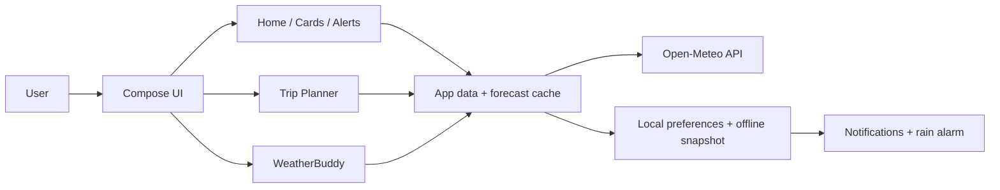

# PersonaWeather

PersonaWeather is a modern Android weather intelligence app built with Kotlin, Jetpack Compose, and Gradle Kotlin DSL. It turns weather data into useful decisions: what matters now, what to pack, whether a trip is safe, and whether a location is comfortable or risky.

A calm, action-first app experience built to feel trustworthy, useful, and offline-aware.

## Repo snapshot

- Kotlin + Compose + Android 36
- Open-Meteo-first weather intelligence
- Offline-safe cached forecast behavior
- On-device WeatherBuddy assistant
- Route-aware Trip Planner with saved forecast windows
- Privacy-conscious local processing

## Why this repo stands out

- Decision-first UX: focuses on action and clarity, not noisy dashboards
- Trust-by-design: explains freshness, coverage, and uncertainty clearly
- Offline resilience: stores provider responses and avoids fabricated values
- Privacy-aware architecture: keeps weather, assistant, and UI data local
- Product-ready structure: implementation + UX research docs kept side-by-side

## High-level architecture



## Data flow

```text
+---------------------+      +------------------------+
| User actions        | ---> | Compose screen state    |
| - choose location   |      | - cards                |
| - open trip         |      | - alerts               |
| - ask WeatherBuddy  |      | - recommendations      |
+---------------------+      +------------------------+
            |                              |
            v                              v
+---------------------+      +------------------------+
| Forecast provider  |      | Local storage          |
| Open-Meteo API      | ---> | cache + user prefs     |
+---------------------+      +------------------------+
            |                              |
            +------------+-----------------+
                         |
                         v
             +---------------------------+
             | Decision layer            |
             | - advisories              |
             | - risk classification     |
             | - trip recommendations    |
             +---------------------------+
                         |
                         v
             +---------------------------+
             | UI output                |
             | alerts, tips, assistant  |
             +---------------------------+
```

## Core features

### Weather and advisory intelligence

- Current conditions, rain risk, AQI, fog/visibility, UV, and heat guidance
- Action-aware advice about what to do next
- Alerts and caution states that distinguish urgency from helpful context

### Trip Planner

- Route-based planning with saved waypoints and geocoded route locations
- Forecast coverage tied to travel timing and route context
- Offline-ready trip decisions limited to the available saved forecast window

### WeatherBuddy

- Floating assistant on Home for weather and navigation questions
- Built from available app data only
- Makes recommendations like go / caution / avoid for tomorrow travel scenarios
- Avoids fabricated outputs when data is missing or unsupported

### Notifications and alarms

- Clothes rain alarm checks selected-location forecast data in the background
- Weather notifications and alarms remain user-controlled and permission-aware
- Background execution respects Android scheduling limitations

## Product principles

- Decision before detail
- Trust first
- Offline-aware
- User-controlled
- Accessible by default

## Project structure

```text
sih/
├── app/
│   ├── src/main/                 # Application code and resources
│   ├── src/test/                # Unit tests
│   └── build.gradle.kts         # App module configuration
├── gradle/                      # Wrapper and version catalog
├── .github/workflows/           # CI for tests, lint, and debug/release builds
├── archive/                     # Legacy prototype; excluded from the active build
├── README.md                    # Project overview
├── PersonaWeather_Implementation_Plan.md
├── PersonaWeather_UX_Research_and_Implementation_Plan.md
├── DECISIONS.md
└── build.gradle.kts
```

The active rules configuration is `app/src/main/assets/persona_rules.json`. The sibling `../c/` folder is an isolated UI gallery and is not included by `settings.gradle.kts`; it is not needed to build, test, or package this standalone project.

## User journey

```text
Start
  |
  v
Welcome -> Personalize -> Select location -> Review dashboard -> Get insight -> Act
                           |                                     |
                           v                                     v
                    Set preferences                   WeatherBuddy / Trip / Alerts
```

## Weather and offline behavior

Weather, air-quality, and marine values come only from Open-Meteo responses. The app stores the exact provider response privately on the device and reuses it when a request is unavailable. Cached forecasts retain their provider timestamps and are not extended beyond their returned coverage; when current or route coverage is missing, the app reports unavailable instead of inventing values.

Opening a route in Trip Planner loads and stores forecasts for its waypoints and remembers geocoded route locations. Open the route while online before a planned offline trek. The trip screen shows the departure-time coverage available from the saved forecasts. Offline use is limited to that provider forecast window.

The clothes rain alarm checks the selected location's provider forecast in the background about every 30 minutes while weather notifications and the alarm are enabled. Android may delay background work, so this is not an exact-time or emergency alert. Allow notification permission for alarm sounds and alert delivery.

## Data and privacy

Weather and place-search requests use Open-Meteo over HTTPS and include the selected coordinates or search text. Forecast responses and preferences are stored in app-private storage. Calendar events are read only after Android grants calendar permission and are processed on-device; this app does not send calendar contents or assistant conversations to a remote service.

## Getting started

### Requirements

- JDK 17+
- Android SDK 36
- Android Studio or equivalent IDE

### Build and test

On Windows:

```powershell
.\gradlew.bat :app:testDebugUnitTest
.\gradlew.bat :app:assembleDebug
```

On macOS or Linux:

```sh
bash gradlew :app:testDebugUnitTest :app:assembleDebug
```

The debug APK is written to `app/build/outputs/apk/debug/`.

## Release and publishing

The current application ID (`com.example.personaweather`) is a placeholder. Before publishing, choose a unique application ID and configure a release signing key through a secure local setup or GitHub Actions secrets. Never commit signing keys, passwords, or machine-specific `local.properties` files. The GitHub workflow validates tests and debug builds; it does not sign or publish a release.

## Final note

This project makes uncertainty explicit instead of hiding it. That makes it feel more trustworthy, more useful in real life, and more product-ready for teams that care about practical weather guidance over flashy but vague weather dashboards.
